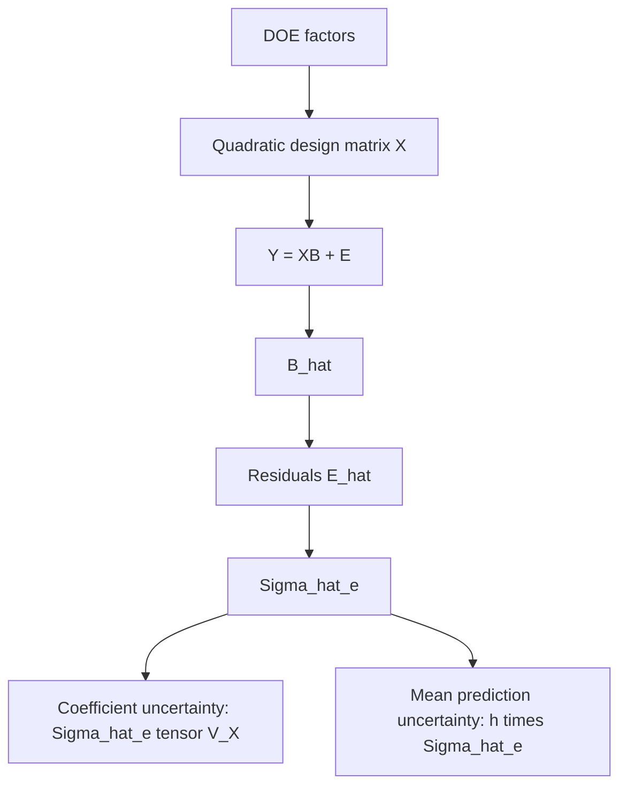

# Estrutura analítica da incerteza RSM

Pressupostos, ajuste e dimensões: [multivariate_rsm.md](multivariate_rsm.md).
Nesta página Sigma é populacional e Sigma_hat_e é sua estimativa residual.
As APIs retornam estimativas plug-in de covariâncias, sem amostragem.

| Conceito | Univariado j | Multivariado |
|---|---|---|
| Resíduos | e_hat_j | E_hat |
| Variância/covariância residual estimada | MSE_j | Sigma_hat_e |
| Covariância estimada dos coeficientes | MSE_j V_X | Sigma_hat_e ⊗ V_X |
| Covariância estimada da média predita | h(x) MSE_j | h(x) Sigma_hat_e |

## Coeficientes e convenção vec

Define-se vec(B_hat) por empilhamento de colunas (`reshape(-1, order="F")`):
primeiro todos os p coeficientes da resposta 1, depois os da resposta 2, etc.
O índice do coeficiente i da resposta j é j*p+i, com índices Python iniciando em 0.
Se A=(X^TX)^(-1)X^T, B_hat-B=AE e AA^T=V_X. Portanto:

\[
\operatorname{Cov}(\hat B_{ij},\hat B_{lk}) = (V_X)_{il}\Sigma_{jk},\qquad
\operatorname{Cov}(\operatorname{vec}\hat B)=\Sigma\otimes V_X.
\]

`coefficient_covariance(result)` retorna a estimativa Sigma_hat_e ⊗ V_X,
de dimensão (pm)×(pm). `coefficient_covariance_by_response(result,j)` retorna
o bloco diagonal p×p igual a MSE_j V_X. Os blocos cruzados são Sigma_hat_e[j,k] V_X.

Sob normalidade dos erros, B_hat ~ MN_(p×m)(B,V_X,Sigma), com covariância
de linhas V_X e de colunas Sigma, nesta convenção. Substituir Sigma por
Sigma_hat_e fornece uma estimativa da covariância; não transforma essa distribuição
amostral em uma lei exata conhecida ou posterior para B.
Sem normalidade, as identidades de covariância continuam válidas sob os
pressupostos de segundo momento; a afirmação de distribuição normal não segue.

R003, p.3, apresenta Cov(vec(B_hat^T))=V_X⊗Sigma. A transposição e a ordem dos
fatores não são copiadas silenciosamente: trata-se da permutação dos mesmos
elementos. Os testes verificam explicitamente essa permutação e cada bloco.

## Média predita e covariância cruzada

Para z(x), coluna da base canônica, mu_hat(x)=B_hat^T z(x).
Defina q(x)=solve(R^T,z(x)). Então:

\[
h(x)=z(x)^TV_Xz(x)=q(x)^Tq(x),\qquad
\operatorname{Cov}[\hat\mu(x)]=h(x)\Sigma.
\]

`prediction_leverage` retorna h; `mean_prediction_covariance` retorna
h Sigma_hat_e e `mean_prediction_variance` retorna h MSE por resposta.
Suas diagonais coincidem. É incerteza da média estimada pelos coeficientes
compartilhados. Não se acrescenta o termo de uma nova observação: não há 1+h.

Para dois pontos, h_cross_ab=z_a^TV_Xz_b=q_a^Tq_b. Pode ser negativo.
`cross_prediction_covariance` retorna h_cross_ab Sigma_hat_e. As predições não
são independentes porque dependem da mesma matriz de coeficientes estimada.

## Diferenças entre médias preditas

Se c=z_a-z_b, defina q_c=solve(R^T,c) e h_ab=q_c^Tq_c=c^TV_Xc. Então:

\[
\operatorname{Cov}[\hat\mu(x_a)-\hat\mu(x_b)]=h_{ab}\Sigma.
\]

Isso também segue de Cov(A-B)=Cov(A)+Cov(B)-Cov(A,B)-Cov(B,A), pois
h_ab=h_a+h_b-h_cross_ab-h_cross_ba.
Somar apenas covariâncias marginais geralmente fornece uma resposta errada.
`difference_prediction_covariance` retorna h_ab Sigma_hat_e;
`difference_prediction_leverage` retorna h_ab.
Para x_a=x_b, c=0 e a covariância é exatamente zero. Ao trocar a e b, a média
da diferença troca de sinal, mas a covariância permanece a mesma.

Estas extensões são MATHEMATICAL_DERIVATION a partir da covariância dos
coeficientes; não são atribuídas a uma equação não verificada da publicação.

## Cadeia conceitual

## Evidências e limites

R003, seção 2, p.3, Eqs.(5)-(6), sustenta a covariância da média multivariada;
R004, p.22 Eq.(2.16) e p.33 Eq.(2.40), sustenta os equivalentes univariados.
Ver [cobertura de leitura e versões](../../references/notes/rsm_foundation_sources.md)
e [claims C-RSM-01 a 06](../../references/notes/claims_matrix.md).
Os testes são analíticos e sintéticos, sem inferência sobre adequação do experimento
real, intervalos, testes t, shrinkage, confidence regions ou otimização.
