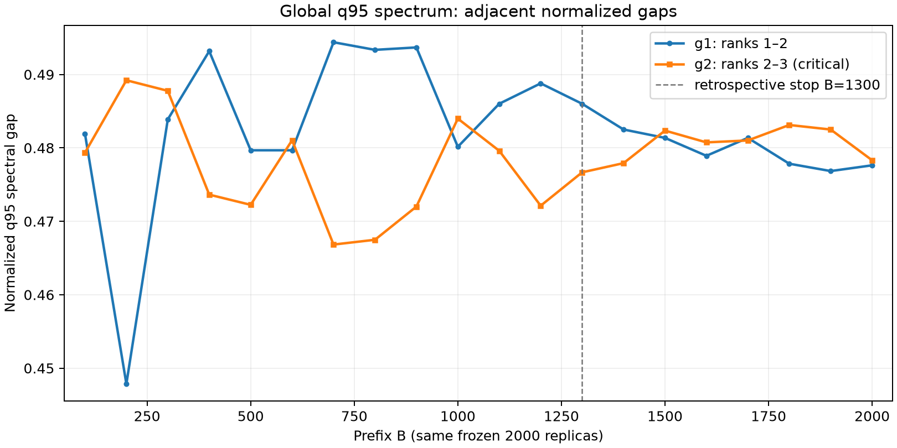

# Turning: fixed-normalization centered CHIM and local spectral screening

Date: 2026-10-24. Run: turning_fixed_nominal_chim_pa_777_20261024.
Branch: feature/05-chim-svd-local-pa. Actual numerical source commit:
**257d1942b452c427b5f8ef7924fddf31975c3ad3**, working tree clean.
The artifact-delivery commit adds this report/results afterwards; metadata
continues to identify the actual source of the scientific computation.

## Frozen canonical inputs and validity

Nominal: Phase 2 **sphere-only payoff_sphere.csv**, not RC, a Monte Carlo mean,
a publication reconstruction or fixed-anchor reevaluation. SHA-256:
`2e410a2d3e222047442d75d526166c6af5e5d6787c2c93dcbe2b184003e124c2`.
Phase 4 payoff_samples.npz SHA-256:
`98a12097a25cf2178e8ffce79499ad627cfb8345fd00a31b3b1521d88c6407d1`;
scientific source ac9eb72af9f91de2b860df4b17ba8ab417e94e07, metadata hash
6c5a81c75e2ca759f1daa54235b270f30527ed21fafe0d932c3e9bfc7b13250d.
Finite float64 (2000,8,8), all validity masks, source metadata/order and diagonal
equality against archived Phase 4 optimal values were verified before analysis.
Phase 3 seed remains 777; no new draws, OLS, reoptimization or RC.

Dataset SHA: 7f905b7a2f7bb8b6735ab96900cba7356401df2d26c961dcb12faa2683c6c71e.
All **21** Phase 5 input hashes were checked against current files and their
committed source blobs. All ten output checksums passed. Replaying every
nominal/noise spectral computation from the frozen payoff arrays reproduced
all global/pair/triple/quadruple noise arrays bitwise in the same environment.
No prior scientific module, data, artifact, policy byte or uv.lock was altered.

## Orientation and one fixed normalization

Rows/responses and columns/anchors share order T,MTTF,WR,Ra,Rt,Kp,ROI,OEE.
MIN signs are (-1,-1,+1,+1,+1,+1,-1,-1), G=D_s A.
For nominal only: u_i=G_ii, a_i=max_j G_ij-u_i. Every replica uses
Z=(D_s A-u)/a with these same u/a. No clipping or per-replica normalization.
The diagonal-optimality and strictly positive/nondegenerate amplitude gates
passed with only the documented certificate/float64 allowances. Display values
are rounded to nine significant digits; artifacts retain full float64 precision.

| Response | Direction | Sign | Oriented Utopia u | Fixed amplitude a |
|---|---|---|---|---|
| T | MAX | -1 | -66.1444764 | 37.8316359 |
| MTTF | MAX | -1 | -68.8976706 | 38.1473199 |
| WR | MIN | 1 | 0.00421457666 | 0.00790169819 |
| Ra | MIN | 1 | 0.280668816 | 2.04198237 |
| Rt | MIN | 1 | 1.84046438 | 6.22808079 |
| Kp | MIN | 1 | 1.65000077 | 3.43944963 |
| ROI | MAX | -1 | -0.306345653 | 0.269476585 |
| OEE | MAX | -1 | -0.576892134 | 0.348822763 |

## Centered geometry and global screening

For every C use exactly matching response/anchor submatrix Z[C,C], then right
multiply by H_k=I-ones/k. Observed spectrum is SVD(Z_nom[C,C] H_k); uncertainty
reference is SVD(Delta[C,C] H_k), Delta=D_a^-1 D_s(A_b-A_nom), retaining k-1
components. No across-replica mean is subtracted from Delta. Nominal normalized
diagonal is zero, row maxima one; centered maximum absolute vertex sum is
**3.3306690738754696e-16**. Numerical centered rank and reference-difference rank
are both **7**, distinct from the uncertainty-screened leading dimension below.

q=.95, explicit linear quantiles, strict observed>q95, no added PA margin.

| r | Observed sigma | q95 B2000 | Margin | Pass |
|---|---|---|---|---|
| 1 | 2.91681179 | 1.1037221 | 1.81308969 | True |
| 2 | 0.912730323 | 0.57655301 | 0.336177313 | True |
| 3 | 0.165287374 | 0.300779067 | -0.135491693 | False |
| 4 | 0.0729834106 | 0.139830748 | -0.0668473372 | False |
| 5 | 0.0280071543 | 0.0583302952 | -0.030323141 | False |
| 6 | 0.00943317067 | 0.018330886 | -0.00889771532 | False |
| 7 | 0.000180591098 | 0.00229799285 | -0.00211740175 | False |

Global supported leading dimension: **2**. Pattern PASS,PASS,FAIL,FAIL,FAIL,FAIL,FAIL.
No NON_MONOTONE_PA_PATTERN occurred at any of the 20 checkpoints. This is a
conditional uncertainty-calibrated spectral screening result, not a classical
Horn factor test, physical-model validation or a reduction of algebraic rank to two.

## Local selection at B=2000

All candidates were assessed: **28 pairs, 56 triples, 70 quadruples =154**.
The global result did not prefilter any candidate. Selected: **19 pairs,
18 triples, 0 quadruples =37**, using every k-1 strict component comparison.
Exact selected identities follow (response labels are separated by pipes in CSV).

### Pairs (19)

| Subset ID | Responses |
|---|---|
| C_1_4 | T / Ra |
| C_1_5 | T / Rt |
| C_1_6 | T / Kp |
| C_1_7 | T / ROI |
| C_2_4 | MTTF / Ra |
| C_2_5 | MTTF / Rt |
| C_2_6 | MTTF / Kp |
| C_2_7 | MTTF / ROI |
| C_3_4 | WR / Ra |
| C_3_5 | WR / Rt |
| C_3_6 | WR / Kp |
| C_3_7 | WR / ROI |
| C_4_6 | Ra / Kp |
| C_4_7 | Ra / ROI |
| C_5_6 | Rt / Kp |
| C_5_7 | Rt / ROI |
| C_6_7 | Kp / ROI |
| C_6_8 | Kp / OEE |
| C_7_8 | ROI / OEE |

### Triples (18)

| Subset ID | Responses |
|---|---|
| C_1_4_6 | T / Ra / Kp |
| C_1_4_7 | T / Ra / ROI |
| C_1_5_6 | T / Rt / Kp |
| C_1_5_7 | T / Rt / ROI |
| C_1_7_8 | T / ROI / OEE |
| C_2_4_6 | MTTF / Ra / Kp |
| C_2_4_7 | MTTF / Ra / ROI |
| C_2_5_6 | MTTF / Rt / Kp |
| C_2_5_7 | MTTF / Rt / ROI |
| C_2_7_8 | MTTF / ROI / OEE |
| C_3_4_6 | WR / Ra / Kp |
| C_3_4_7 | WR / Ra / ROI |
| C_3_5_6 | WR / Rt / Kp |
| C_3_5_7 | WR / Rt / ROI |
| C_3_7_8 | WR / ROI / OEE |
| C_4_7_8 | Ra / ROI / OEE |
| C_5_7_8 | Rt / ROI / OEE |
| C_6_7_8 | Kp / ROI / OEE |

### Quadruples (0)

None selected. All 70 candidates were evaluated.

Every candidate's observed singular values, thresholds, margins, component
passes and selected flag are in local_pa_B2000.csv, including the 117 rejected
subsets. selected_subsets_B2000.csv contains exactly the 37 rows above.
No qmax, condition/ratio, volume/determinant, global-dimension, sampler-error or
anchor-displacement filter was used. No legacy count was a target/test oracle.

## Complete B trajectory and original early-stop policy

All 357 decision quantiles (7 global +350 local) were tracked for each of the
same 20 prefixes. The following maximum changes are relative ratios, not percent.
First-checkpoint NA has no predecessor. Eligibility starts at B=500 versus400.

| B | Global d | Pairs | Triples | Quadruples | Total | IDs changed | Max relative q change | Stop met |
|---|---|---|---|---|---|---|---|---|
| 100 | 2 | 19 | 22 | 1 | 42 | NA | NA | False |
| 200 | 2 | 20 | 18 | 0 | 38 | True | 0.293589949 | False |
| 300 | 2 | 20 | 18 | 0 | 38 | False | 0.171028836 | False |
| 400 | 2 | 20 | 17 | 0 | 37 | True | 0.242727921 | False |
| 500 | 2 | 19 | 17 | 0 | 36 | True | 0.158649044 | False |
| 600 | 2 | 19 | 18 | 0 | 37 | True | 0.0790531007 | False |
| 700 | 2 | 19 | 18 | 0 | 37 | False | 0.122934811 | False |
| 800 | 2 | 19 | 18 | 0 | 37 | True | 0.106544981 | False |
| 900 | 2 | 19 | 19 | 0 | 38 | True | 0.056544986 | False |
| 1000 | 2 | 19 | 19 | 0 | 38 | False | 0.0606104589 | False |
| 1100 | 2 | 19 | 18 | 0 | 37 | True | 0.062961792 | False |
| 1200 | 2 | 19 | 18 | 0 | 37 | False | 0.0580175496 | False |
| 1300 | 2 | 19 | 18 | 0 | 37 | False | 0.0427456553 | False |
| 1400 | 2 | 19 | 18 | 0 | 37 | False | 0.0512071828 | False |
| 1500 | 2 | 19 | 18 | 0 | 37 | False | 0.0664679638 | False |
| 1600 | 2 | 19 | 18 | 0 | 37 | False | 0.0391579517 | False |
| 1700 | 2 | 19 | 18 | 0 | 37 | False | 0.0586858668 | False |
| 1800 | 2 | 19 | 18 | 0 | 37 | False | 0.0299026388 | False |
| 1900 | 2 | 19 | 18 | 0 | 37 | False | 0.0383665882 | False |
| 2000 | 2 | 19 | 18 | 0 | 37 | False | 0.044577589 | False |

A concrete identity check matters: between B=700 and800, counts stay 19 pairs,
18 triples, 0 quadruples, yet C_5_7_8 (Rt,ROI,OEE) is replaced by C_3_6_8
(WR,Kp,OEE). The identity change is recorded as True. Selected identities are
unchanged from B=1100 through2000, but this does not by itself satisfy the policy.

Original policy SHA: **e738a49b7df5aca0beaca8ed7a4229dbbfeed2aecd5160de0a4414eda73b43db**.
Its bytes and PROPOSED status were preserved. The exact epsilon_q is
2.2250738585072014e-308; every global/local decision threshold, including those
of rejected candidates, enters the strict <1% maximum-change condition.

**B_stop=None; EARLY_STOP_NOT_REACHED.** No checkpoint met all three criteria.
The smallest observed maximum relative change was about 2.99026% at B=1800;
at B=2000 it was 4.45776%, both above 1%. Thus retrospective stop stability is
**NOT_APPLICABLE_NO_EARLY_STOP**, not a fabricated stable-stop claim.
This is not an execution error. All checkpoints, 7140 threshold/decision rows,
and B=2000 reference results were retained. Policy promotion: **false**.

## Archive, reproducibility and quality

[Reviewed run](../../results/phase_05_chim_pa/turning_fixed_nominal_chim_pa_777_20261024/)
contains nominal_normalization.csv, global_pa_B2000.csv, local_pa_B2000.csv,
selected_subsets_B2000.csv, prefix_pa_sensitivity.csv, pa_quantile_trajectories.csv,
pa_noise_singular_values.npz, nominal_chim.npz, early_stop_validation.json,
metadata.json and checksums.sha256. Payload: **6096674 bytes**, about 6.10 MB.
No thousands of files or LFS. NPZ arrays are numeric, allow_pickle=False:

- global (2000,7);
- pairs (2000,28,1), indices (28,2);
- triples (2000,56,2), indices (56,3);
- quadruples (2000,70,3), indices (70,4).

The serial measured workflow before metadata serialization took
**1.0827732000034302 s**. No multiprocessing, GPU, reoptimization or random draw.

| Output | SHA-256 |
|---|---|
| early_stop_validation.json | f00bd2e0b871813e08ea7a5a7380c9f2103b1ea17c5980e01045dac225ec96ec |
| global_pa_B2000.csv | 694a1243917ae9b6c29a96e9ccb0ac311bcc61a7910e433dfe361967c9781b6f |
| local_pa_B2000.csv | 244d77ef82a6d5fa7b8bb60984641248cf763ef370dc894522196087f652118e |
| metadata.json | 61f84b930aa8b0adb9a9bc48f2129dbcc675f73bc582d7053f500188d5f87992 |
| nominal_chim.npz | 181420d3baec324fe02df7274c7130452e562ef5974e527fe63da5c935e6eb40 |
| nominal_normalization.csv | bc19f7ef44d5ee86b10b4fb789fe55742b0dc6dc2119277d5811e7464bb76dc0 |
| pa_noise_singular_values.npz | 4496326958f35ad7a322702e43db3d99eade1497d98e0b179974d424b5e71dba |
| pa_quantile_trajectories.csv | 15df4a3c7a18674f65a04bb633ddf2fe0fb506b9d00874777aec4f9fe925d441 |
| prefix_pa_sensitivity.csv | 171b3679573b1a624628569d388ed3f6fba875e3aabcc02bdfe1d26a655f343c |
| selected_subsets_B2000.csv | 198d03f7756ba9f0633d87a6142e5ac6da014a135f78df405994cc10b6b77e46 |

Locked sync, pytest -v, pytest --cov=cnbi_v2, Ruff and strict mypy passed:
**453 tests; 99.44% (1417/1425 statements); new chim/ 100%; previous scientific
modules 100%; mypy 25 source files**. Only eight pre-existing workbook-inspector
statements remain uncovered. No dependency/lock change. CI is verified on the
delivered PR head; see [gate](../phase_5_verification.md).

ADR 0008 ACCEPTED, C-PA-01/02/03/04 recorded. Mathematical proof/API:
[chim_parallel_analysis.md](chim_parallel_analysis.md). Sources R006/Horn and
R007/Jolliffe-Cadima were checked with explicitly PARTIAL coverage; this is
PA-inspired uncertainty screening, with no claimed classical equivalence or
simultaneous testing guarantee.

## Original recommendation before the stopping-policy revision below

Use **B=2000 and these 37 subsets** as the present reference selection. Retain
the stopping policy as PROPOSED and do not deploy early termination from this
single trajectory. Define lattice resolution/weights and downstream NBI validation
only under a new explicit task; no H was chosen. Near-threshold margins remain
visible in the CSVs and are not altered to match legacy counts.

No RC, clipping, volume/qmax gate, new Monte Carlo, anchor reoptimization,
shrinkage, lattice H/weights, NBI/C-NBI, clustering, nondominance or Pareto metrics.
No subsequent phase was started automatically.

## Spectral-gap convergence and revised early-stop policy

Explicit pre-merge PR #8 revision, **policy v2 PROPOSED_REVISED**, ADR 0009
**PROPOSED**. The policy was defined after inspecting the original turning
trajectory; this is a **post-hoc same-case analysis**, not external validation
of the five-percentage-point rule. V1 and all original artifacts above remain
byte-identical and retain their historical not-reached outcome.

The revised run is
[turning_spectral_gap_policy_v2_20261024](../../results/phase_05_chim_pa/turning_spectral_gap_policy_v2_20261024/).
It consumes only saved spectra and observed/decision CSVs. No new draws,
anchors, payoffs, normalization, CHIM or SVD are executed by the revision.
All 7140 historical q95/observed/margin/PASS rows and every prefix dimension,
selection count and exact ID set matched. No gap became a PA filter.

The old criterion max_q abs(q_B-q_previous)/max(abs(q_B),abs(q_previous),epsilon_q)
<.01 is now a legacy diagnostic only. It could be controlled by one of the357
individual thresholds, including small/rejected-subset values. The revised
object is the relative spectral shape:

\[
d_r=q_r-q_{r+1},\qquad
g_r=\frac{q_r-q_{r+1}}{\max(q_r,\epsilon_q)},\qquad
\Delta g_r=|g_r(B)-g_r(B-100)|<.05.
\]

Five percentage points is an operational tolerance, not statistical error.
The same six global gaps and all stable selected local k>=3 gaps must satisfy
it in both transitions of a three-eligible-checkpoint window. Pair identities
remain part of the exact-set stability requirement, without artificial gaps.
The first eligible window is500/600/700. Observed singular values still define
PASS/FAIL but do not measure Monte Carlo convergence. No degeneracy was found:
**DEGENERATE_Q95_SPECTRUM: NOT_DETECTED**.

### Complete global gap trajectory

Normalized gaps below are fractions; all six are in
[global_spectral_gap_trajectory.csv](../../results/phase_05_chim_pa/turning_spectral_gap_policy_v2_20261024/global_spectral_gap_trajectory.csv).
Global dimension is2 at every checkpoint; g2 is the critical rank2–3 gap.

| B | g1 | critical g2 | g3 | g4 | g5 | g6 |
|---|---|---|---|---|---|---|
| 100 | 0.481936 | 0.479340 | 0.504007 | 0.545430 | 0.745182 | 0.883507 |
| 200 | 0.447858 | 0.489214 | 0.540333 | 0.557870 | 0.698702 | 0.887914 |
| 300 | 0.483887 | 0.487773 | 0.506012 | 0.597728 | 0.647739 | 0.894714 |
| 400 | 0.493176 | 0.473635 | 0.508880 | 0.602387 | 0.652967 | 0.885949 |
| 500 | 0.479678 | 0.472247 | 0.522879 | 0.608500 | 0.658027 | 0.884872 |
| 600 | 0.479678 | 0.481047 | 0.513938 | 0.601830 | 0.663856 | 0.890749 |
| 700 | 0.494390 | 0.466836 | 0.524350 | 0.595338 | 0.668423 | 0.889063 |
| 800 | 0.493355 | 0.467488 | 0.529357 | 0.596182 | 0.668077 | 0.879191 |
| 900 | 0.493684 | 0.472008 | 0.536420 | 0.590231 | 0.667375 | 0.881223 |
| 1000 | 0.480148 | 0.483991 | 0.538496 | 0.587318 | 0.669888 | 0.881066 |
| 1100 | 0.486014 | 0.479604 | 0.540969 | 0.589255 | 0.662095 | 0.880771 |
| 1200 | 0.488791 | 0.472127 | 0.541467 | 0.581894 | 0.669869 | 0.880478 |
| 1300 | 0.486010 | 0.476673 | 0.537859 | 0.581997 | 0.672889 | 0.879640 |
| 1400 | 0.482508 | 0.477924 | 0.542472 | 0.578416 | 0.674380 | 0.879446 |
| 1500 | 0.481364 | 0.482359 | 0.535944 | 0.581894 | 0.680701 | 0.876590 |
| 1600 | 0.478924 | 0.480751 | 0.535814 | 0.575575 | 0.687772 | 0.876353 |
| 1700 | 0.481364 | 0.481014 | 0.534730 | 0.578950 | 0.687242 | 0.873828 |
| 1800 | 0.477846 | 0.483122 | 0.536191 | 0.577448 | 0.685946 | 0.873412 |
| 1900 | 0.476846 | 0.482502 | 0.535947 | 0.582950 | 0.684242 | 0.872898 |
| 2000 | 0.477628 | 0.478315 | 0.535105 | 0.582851 | 0.685740 | 0.874638 |

### Transition and window sensitivity

Change columns are **percentage points** (100 times the absolute normalized-gap
change). The current and preceding transitions use the same monitor set for
the window ending at B. Before a complete/eligible window these are diagnostics
only. Exact dimension/selection equality is also required; a small gap change
alone never triggers stopping.

| B | Global max change (pp) | Selected local max change (pp) | Overall current transition (pp) | Two-transition window max (pp) | Eligible | Exact selection stable for3 | Stop condition |
|---|---|---|---|---|---|---|---|
| 100 | — | — | — | — | False | False | False |
| 200 | 4.647998 | 5.440219 | 5.440219 | — | False | False | False |
| 300 | 5.096332 | 5.239781 | 5.239781 | 5.440219 | False | False | False |
| 400 | 1.413831 | 2.592290 | 2.592290 | 5.239781 | False | False | False |
| 500 | 1.399881 | 2.475080 | 2.475080 | 2.592290 | False | False | False |
| 600 | 0.894067 | 2.294828 | 2.294828 | 2.475080 | False | False | False |
| 700 | 1.471211 | 0.700043 | 1.471211 | 2.294828 | True | False | False |
| 800 | 0.987147 | 1.848241 | 1.848241 | 1.848241 | True | False | False |
| 900 | 0.706325 | 1.311697 | 1.311697 | 1.848241 | True | False | False |
| 1000 | 1.353598 | 1.150614 | 1.353598 | 1.353598 | True | False | False |
| 1100 | 0.779285 | 1.522144 | 1.522144 | 1.522144 | True | False | False |
| 1200 | 0.777379 | 1.169563 | 1.169563 | 1.522144 | True | False | False |
| 1300 | 0.454600 | 0.971192 | 0.971192 | 1.169563 | True | True | True |
| 1400 | 0.461269 | 1.179158 | 1.179158 | 1.179158 | True | True | True |
| 1500 | 0.652808 | 0.804398 | 0.804398 | 1.179158 | True | True | True |
| 1600 | 0.707089 | 0.809266 | 0.809266 | 0.809266 | True | True | True |
| 1700 | 0.337476 | 0.795895 | 0.795895 | 0.809266 | True | True | True |
| 1800 | 0.351724 | 0.893146 | 0.893146 | 0.893146 | True | True | True |
| 1900 | 0.550278 | 0.643292 | 0.643292 | 0.893146 | True | True | True |
| 2000 | 0.418717 | 0.848871 | 0.848871 | 0.848871 | True | True | True |

The local monitor set is the intersection of selected k>=3 identities in each
window; exact equality of the full selections is independently required. The
relevant window sets can be specified without repeating IDs on every row.
Let M be these18 final selected trios:

`C_1_4_6`, `C_1_4_7`, `C_1_5_6`, `C_1_5_7`, `C_1_7_8`, `C_2_4_6`, `C_2_4_7`, `C_2_5_6`, `C_2_5_7`, `C_2_7_8`, `C_3_4_6`, `C_3_4_7`, `C_3_5_6`, `C_3_5_7`, `C_3_7_8`, `C_4_7_8`, `C_5_7_8`, `C_6_7_8`.

All relevant eligible windows contain no selected quartet. Every row also
monitors all6 global gaps. Pair selection is checked by full IDs, not gaps.

| Window ending B | Local monitor IDs | Total gaps | Full selected-ID equality in window |
|---|---|---|---|
| 700,800,900 | M except C_5_7_8 | 23 | False |
| 1000 | M except C_5_7_8, plus C_3_6_8 | 24 | False |
| 1100,1200 | M | 24 | False |
| 1300,1400,...,2000 | M | 24 | True |

Exact IDs for every window, including all pairs in the full selected set, are
in [window_monitoring.csv](../../results/phase_05_chim_pa/turning_spectral_gap_policy_v2_20261024/window_monitoring.csv).
All4040 gaps, including unmonitored spectra, are in spectral_gap_trajectories.csv;
flags identify monitor membership. No pair gap was fabricated.

### First stop and retrospective decisions

The **computed first joint success is B_stop_gap=1300**, using1100/1200/1300.
Earlier eligible windows fail exact selected-ID equality, even when counts
coincide. At1300 all24 monitored gaps satisfy the strict limit in both
transitions: maximum **1.1695626398 pp** for1100→1200 and **0.9711924477 pp**
for1200→1300. The global maximum for the latest transition is0.4546002924 pp.

At the stop: global dimension2, **19 pairs+18 triples+0 quadruples=37 subsets**.
Their complete identities are exactly the original37 listed above and stored
in selected_subsets_B2000.csv. The revised early_stop_validation.json also
records the full stop and reference ID lists, independently compared:

- same_final_selection=true; same_final_dimension=true.
- Every later checkpoint1400,1500,...,2000 preserves both decisions.
- EARLY_STOP_RETROSPECTIVELY_DECISION_STABLE; changed_later_checkpoints=[].
- post_stop_max_gap_change=0.011791584724043402, or **1.1791584724 pp**, at1400.
- No post-stop transition violates .05. A gap-only violation would still be
  reported separately rather than classified as a premature decision.
- replicate_reduction_fraction=1-1300/2000=0.35, **35% potential replica
  reduction** (700 replicas), not measured wall-clock savings. The full frozen
  ensemble already existed and was retained as the scientific reference.

### Provenance, integrity and validation limits

Source committed before canonical execution:
**5a2b6cdb8595c5524af5cdfe2af076a2125366b8**, dirty=false.
Original archive commit fc57b05c96a72a8cc6128f49ef270a689cc9bac0.
All17 input hashes match that clean source commit's Git blobs; all7 output
hashes passed. Policy v2 SHA-256:
`70f1ea6b7a771dc3355d04589340997ed3c5d7085271a3a13f217c65f1f43fec`.
Original noise NPZ remains
`4496326958f35ad7a322702e43db3d99eade1497d98e0b179974d424b5e71dba`.

| Revised artifact | SHA-256 |
|---|---|
| early_stop_validation.json | 47747a4361629f10c8ffbac72f22a793cbcbe009d72894863f87ad2080adabc2 |
| global_q95_spectral_gaps.png | 7dc1ebe87d893a013ca13e0d00166e523de415bfe46e6e8a99450f17af1f6fc7 |
| global_spectral_gap_trajectory.csv | a882ca7879b02a17f4c3804053a98d305b222dd3c7a1105135bd32a4025643c9 |
| metadata.json | bfdcb1451c7e63ac87ef27aaeca8a25f7ca1d1cc7ca8f56c9806a394f9e842ec |
| prefix_pa_sensitivity.csv | 37d7ee806258b32713bd8dc00bc9d8eff1878901256a15a159b1f83e14e6cc2e |
| spectral_gap_trajectories.csv | fc4b9eb4a1d0e37e6aabdd80d6405915f07d68d0e2ea2f206f181d56c7bf59a4 |
| window_monitoring.csv | 1c971729f7ad4421003525d32a4d86d4f954ffb5d25495098cef27951888d903 |

Manifest:
[checksums.sha256](../../results/phase_05_chim_pa/turning_spectral_gap_policy_v2_20261024/checksums.sha256).
The original Phase2/3/4/5 scientific artifacts, raw data, model/optimizer/sampler
modules, normalization/geometry/PA-selection code, uv.lock and ADR0008 have no
diff from the pre-revision head. Only the historical policy paths changed in
old runner scripts. No upstream canonical workflow was invoked for this analysis.
Regression tests exercise prior modules in temporary directories and cannot
replace the preserved scientific archives.

Final local gate: **502 tests passed**, coverage **99.50% (1577/1585 statements)**,
new spectral_gap_stop.py159/159 and chim/100%; Ruff passes, strict mypy passes
on26 source files, locked sync and git diff --check pass. Eight previously
uncovered workbook-inspection statements are unchanged. The dedicated revised
workflow integration test forbids SVD, RNG, fitting, optimizer and all original
pipelines; independent checks cover every saved gap and window/decision identity.

ADR0009 remains PROPOSED, policy v2 PROPOSED_REVISED, claims C-PA-05/06/07
are supported decision/definition records within their stated limits. Freeze
this exact rule for independent synthetic/application validation; neither these
implementation tests nor this same-case retrospective outcome establish
universal validity. Keep B=2000 as the complete scientific reference. No merge,
lattice H, NBI/C-NBI or new phase was started.
