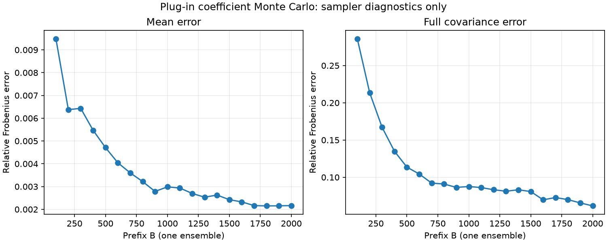

# Turning: joint coefficient Monte Carlo, Phase 3

Run: turning_original_codes_mc_777_20261024, 2026-10-24.
Branch: feature/03-multivariate-coefficient-monte-carlo.
Source commit: 5a102dd337a5c9b7108fac6997b612c7d02a8684, working tree clean.
The later delivery commit adds this report and the reviewed outputs; metadata
continues to identify the actual numerical source commit, not its descendant.

## Canonical model and input integrity

Same original-coded case as Phase 2 run turning_original_codes_20261024,
coding_id original_spreadsheet_codes_1_682. Order x1=Vc, x2=f, x3=ap;
literal source axial codes plus/minus 1.682. This is the previously accepted
distinct coded case, not a reparameterization of the physical model or a fit
to published coefficients. B_hat agrees with the archived Phase 2 CSV under
the documented platform tolerance (rtol=1e-12, atol=1e-13).

One existing fitter supplies B_hat (10,8), R/V_X (10,10), raw Sigma_e (8,8),
N=19 and nu=9. Coefficient order beta0,beta1,beta2,beta3,beta11,beta22,beta33,
beta12,beta13,beta23; responses T,MTTF,WR,Ra,Rt,Kp,ROI,OEE.
Response values and native scales are preserved, including full-precision WR.

SHA-256 identities (float64 object bytes are C-order, little endian):

| Object | SHA-256 |
|---|---|
| Literal raw CCD_values_20261023.xlsx | 7f905b7a2f7bb8b6735ab96900cba7356401df2d26c961dcb12faa2683c6c71e |
| B_hat | 024158093941f9442b7250deceb4b5dc6580fbfd85458add5606850139acb0be |
| V_X | 0e5d964454fe6f7db36ac921d2a110cf629201d50b02f517d1484a86f4f76fee |
| Sigma_hat_e (raw and effective identical) | 9c990a6240cf186f51b57eaf41bb1a2dc40fd59a801cf3dc51274fc192319aeb |
| samples array bytes | 1dcb502be87330097a113b9ed6bf0ade06abc6754c35ac8eade28cb2b69620af |
| coefficient_samples.npz file | 5df42af4ef36fe6e2ce1948897d12a0d90a4a9f3449b1180898cf6adc9d84674 |

All input hashes, including canonical codes, source metadata, earlier coefficient
CSV, model/sampler scripts and lock, were checked against both current files and
their **committed source blobs**. All output checksums were verified. Raw bytes
and modification time are preserved. Historical raw, all processed data, prior
results and existing model/optimization implementation have no diff from main.

## Sampling and factor reconstruction

B_sample=B_hat+C_X G L_Sigma^T, C_X=solve_triangular(R,I).
Maximum absolute C_X C_X^T minus fitter V_X: **0.0**.
Residual covariance factorization: **CHOLESKY_SPD**; maximum absolute
L_Sigma L_Sigma^T minus raw Sigma_hat_e: **1.7763568394002505e-15**.
Zeroed negative eigenvalues: **0**. The generic PSD fallback and its explicit
roundoff tolerance are tested, but this real run required no correction.
No jitter, shrinkage, diagonal covariance substitute or bootstrap was used.

Seed **777**, RNG **Generator(PCG64)**, one ensemble, B_max **2000**, batch size
**100**, dtype float64, shape **(2000,10,8)**. Each replica contains 80 coefficients;
160,000 independent standard normals are transformed jointly. Normal flat order
is replica,term,response with response fastest; column vec is used for covariance.
Repetition, prefixes and chunking are bitwise equal in the supported same
numerical environment, as covered by deterministic tests. Cross-platform bytes
are not promised; environment and factor/object identities are archived.

## B sensitivity

Definitions and derivation: [coefficient_monte_carlo.md](coefficient_monte_carlo.md).
All values below are **relative Frobenius errors**, not percentages. CSV stores
the unrounded float64 decimal representations; this display uses nine decimals.
Each row uses a prefix of the same archived array and unbiased covariance
(B-1 divisor), compared with existing coefficient_covariance(fit).

| B | mean_relative_frobenius_error | covariance_relative_frobenius_error |
|---:|---:|---:|
| 100 | 0.009484441 | 0.285881762 |
| 200 | 0.006376790 | 0.213342393 |
| 300 | 0.006432367 | 0.167032665 |
| 400 | 0.005469533 | 0.134875627 |
| 500 | 0.004710239 | 0.113633095 |
| 600 | 0.004042247 | 0.104337558 |
| 700 | 0.003599256 | 0.092154376 |
| 800 | 0.003219242 | 0.090873774 |
| 900 | 0.002785993 | 0.086369709 |
| 1000 | 0.002986919 | 0.087570137 |
| 1100 | 0.002935529 | 0.086162939 |
| 1200 | 0.002697404 | 0.083240147 |
| 1300 | 0.002532568 | 0.081241705 |
| 1400 | 0.002627404 | 0.083202478 |
| 1500 | 0.002423808 | 0.080791514 |
| 1600 | 0.002326572 | 0.069708744 |
| 1700 | 0.002163636 | 0.072780627 |
| 1800 | 0.002151402 | 0.069948969 |
| 1900 | 0.002154788 | 0.065534654 |
| 2000 | 0.002164325 | 0.061553514 |

At B=2000, exact reported E_mu=**0.0021643250749377695** and
E_K=**0.06155351394347945**, approximately 0.21643% and 6.15535% respectively.
The first-to-last errors decrease, consistent with convergence of the finite-seed
moments; local increases are visible and expected. B was not selected by the
minimum observed error. This is evidence about the sampler, not validation of
the physical adequacy of the RSMs, PA decisions or the full C-NBI methodology.
Native-scale aggregate norms can mask errors in small components; independent
synthetic identity/diagonal/correlated cases and covariance-block tests validate
the full intended structure, including MSE_j V_X and Sigma_jk V_X.

## Future early stop and scope

Policy: [PROPOSED PA early stop](../policies/pa_early_stop_policy.json), registered
before the canonical run. First eligible B=500 versus 400; exact same subset
identities and global dimension plus every decision-quantile relative change
strictly <1%, with epsilon_q=float64.tiny. Stop at first eligible joint success;
otherwise B=2000/EARLY_STOP_NOT_REACHED. Development must still evaluate all20
prefixes. See the derivation document for the explicit relative denominator.
Current status: **NOT_APPLIED_PHASE_3**, early_stop_applied=false.
No PA/subset/singular-value outputs or fictitious decisions were generated.

## Archive and validation

[Reviewed run](../../results/phase_03_coefficient_mc/turning_original_codes_mc_777_20261024/):
metadata.json, mc_prefix_sensitivity.csv, theoretical_covariance.npy,
empirical_covariance_B2000.npy, empirical_summary_B2000.json,
coefficient_samples.npz, mc_convergence.png and checksums.sha256.
Only one compressed array key, samples, is stored. Approximately 1.43 MB total;
PNG visually inspected, labels readable, all 20 plotted checkpoints present.

Quality gate: locked sync, **356 tests**, coverage **99.22%** (1022/1030),
new uncertainty/ 100%, existing model/ and optimization/ 100%, Ruff clean,
mypy strict passed (18 source files). See [gate](../phase_3_verification.md).
ADR 0006 ACCEPTED; C-MC-01/02/03 recorded with derivation/internal/decision
evidence, and finite-seed limits on C-MC-02. CI is checked on the delivered PR head.

No anchor reoptimization, per-replica payoff, Y perturbation, reconstructed data,
OLS duplication, shrinkage, bootstrap, NBI/C-NBI, CHIM, PA or Phase 4 occurred.
Before Phase 4: review this PR and specify per-replica anchor/payoff computation,
solver validity/failure handling and its validation. Existing Phase 1 model
quality and Phase 2 response-region/coding caveats remain; sampling does not
resolve them. No subsequent phase is initiated automatically.
