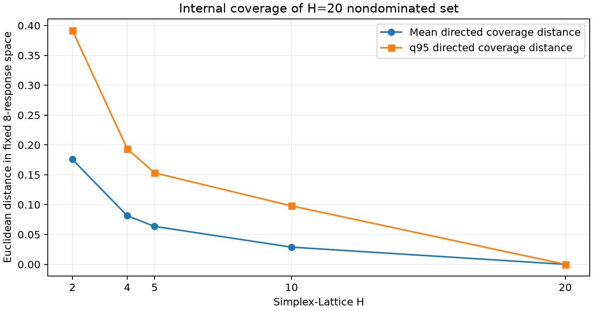

# Turning local NBI and internal H sensitivity

Phase6, ADR0010 ACCEPTED in the explicitly requested scope. PR #8 was reviewed
and squashed as1053f297ad9263d3219532c14f7dfc19fb42c29a after four green checks
and a clean local502-test/Ruff/mypy/locked-sync gate. Branch:
feature/06-simplex-lattice-local-nbi. No later phase or new-PR merge is included.

## Frozen inputs and definition

Source committed before canonical execution:
**d8d3de5f89efcca9d3c52eeac5a2d1d57dac09af**, dirty=false. Run:
[turning_local_nbi_h20_20261024](../../results/phase_06_local_nbi/turning_local_nbi_h20_20261024/).
All21 input hashes match that commit's Git blobs; all12 output checksums passed.
Literal CCD data, current nominal coded RSMs, anchors, payoff, Phase5 normalization,
37 selected identities and every earlier artifact are unchanged.

| Canonical input | SHA-256 |
|---|---|
| dataset_sha256 | 7f905b7a2f7bb8b6735ab96900cba7356401df2d26c961dcb12faa2683c6c71e |
| selected_subsets_sha256 | 198d03f7756ba9f0633d87a6142e5ac6da014a135f78df405994cc10b6b77e46 |
| nominal_model_sha256 | 9d5590b5f2ba43592fa13753cd86afaa583fadbbd4f0d180acb1b5eef0b3e3e9 |
| nominal_anchor_sha256 | 462b6b18002c2ae784758a26ebe500bf95de3a8ff1c504aab6986924d9d5bafd |
| nominal_payoff_sha256 | 2e410a2d3e222047442d75d526166c6af5e5d6787c2c93dcbe2b184003e124c2 |

Other pinned inputs include Phase2/5 metadata and the unchanged Phase5 global
normalization. The metadata records all source/code hashes and actual environment:
Python3.12.15, NumPy2.5.4, SciPy1.18.1, Matplotlib3.11.2, existing uv.lock unchanged.
No fit, stochastic coefficient mean/draw, new PA, anchor optimization or RC was
executed by this scientific workflow. Regression tests exercise old modules in
isolated temporary directories without replacing any canonical archive.

Use alpha=8**.25=1.681792830507429; response order T,MTTF,WR,Ra,Rt,Kp,ROI,OEE;
directions MAX,MAX,MIN,MIN,MIN,MIN,MAX,MAX. For each C, orient A_nom[C,C] to MIN,
take local u=diagonal and a=row_max-u, then V=(G-u)/a and
f_tilde_C(x)=(D_s f_C(x)-u)/a. Every local amplitude is positive/nondegenerate.
This local deterministic normalization differs from the global Phase5 one,
which is preserved exclusively for full8-response diagnostics.

With M=V H_k, use its unique unit left-null normal, choosing n'centroid<0.
The actual maximum orthogonality residual is2.3551386880256624e-16, maximum
unit-norm error1.1102230246251565e-16, and all orientation products range from
-0.9074568393175113 to-0.6758322296935955. Geometry/sign gates all passed.
Complete V,u,a,n,singular values and processing order are in local_geometry.json.

Solve max t subject to f_tilde_C(x)=V beta+t n and alpha²-x'x>=0. Objective,
equality and sphere Jacobians are analytic; no finite differences in production.
SLSQP ftol1e-11, maxiter1000; independently accept only solver-success/finite
results with equality norm<=1e-4 and sphere margin>=-1e-9. t is unrestricted.
SLSQP provides local convergence/feasibility, not a global-optimality certificate.
See [mathematical definition](local_nbi.md).

## Exact37 subset identities and per-subset solver cost

Canonical IDs use one-based response indices. The19 pairs/18 trios/0 quadruples
are consumed directly from selected_subsets_B2000.csv; no legacy/qmax substitution.
Every H20 pair has21 weights; every trio has231. Time is measured serial wall
clock for each subset's parent solves, including continuation and retries.

| Subset | Responses | k | Accepted/parent weights | Solve seconds | Max equality norm |
|---|---|---|---|---|---|
| C_1_4 | T,Ra | 2 | 21/21 | 0.015621 | 1.19394e-12 |
| C_1_5 | T,Rt | 2 | 21/21 | 0.013440 | 1.28924e-12 |
| C_1_6 | T,Kp | 2 | 21/21 | 0.014820 | 2.90853e-13 |
| C_1_7 | T,ROI | 2 | 21/21 | 0.017306 | 3.0441e-13 |
| C_2_4 | MTTF,Ra | 2 | 21/21 | 0.014013 | 1.00251e-12 |
| C_2_5 | MTTF,Rt | 2 | 21/21 | 0.013930 | 7.12053e-13 |
| C_2_6 | MTTF,Kp | 2 | 21/21 | 0.014019 | 2.34588e-13 |
| C_2_7 | MTTF,ROI | 2 | 21/21 | 0.018710 | 1.79764e-13 |
| C_3_4 | WR,Ra | 2 | 21/21 | 0.014845 | 1.89796e-12 |
| C_3_5 | WR,Rt | 2 | 21/21 | 0.013825 | 5.48857e-13 |
| C_3_6 | WR,Kp | 2 | 21/21 | 0.015560 | 7.63237e-14 |
| C_3_7 | WR,ROI | 2 | 21/21 | 0.015574 | 4.12594e-13 |
| C_4_6 | Ra,Kp | 2 | 21/21 | 0.020879 | 4.38759e-13 |
| C_4_7 | Ra,ROI | 2 | 21/21 | 0.017332 | 4.06239e-12 |
| C_5_6 | Rt,Kp | 2 | 21/21 | 0.021794 | 5.35985e-13 |
| C_5_7 | Rt,ROI | 2 | 21/21 | 0.020222 | 5.52362e-12 |
| C_6_7 | Kp,ROI | 2 | 21/21 | 0.014422 | 8.30082e-15 |
| C_6_8 | Kp,OEE | 2 | 21/21 | 0.017544 | 4.84019e-13 |
| C_7_8 | ROI,OEE | 2 | 21/21 | 0.027119 | 3.04411e-13 |
| C_1_4_6 | T,Ra,Kp | 3 | 231/231 | 0.240744 | 7.22901e-12 |
| C_1_4_7 | T,Ra,ROI | 3 | 231/231 | 0.279800 | 6.60433e-12 |
| C_1_5_6 | T,Rt,Kp | 3 | 231/231 | 0.244065 | 3.38773e-12 |
| C_1_5_7 | T,Rt,ROI | 3 | 231/231 | 0.299101 | 4.59636e-12 |
| C_1_7_8 | T,ROI,OEE | 3 | 231/231 | 0.341501 | 8.83082e-12 |
| C_2_4_6 | MTTF,Ra,Kp | 3 | 231/231 | 0.244656 | 6.51954e-12 |
| C_2_4_7 | MTTF,Ra,ROI | 3 | 231/231 | 0.273441 | 6.11622e-12 |
| C_2_5_6 | MTTF,Rt,Kp | 3 | 231/231 | 0.236824 | 1.08251e-12 |
| C_2_5_7 | MTTF,Rt,ROI | 3 | 231/231 | 0.313303 | 5.99597e-12 |
| C_2_7_8 | MTTF,ROI,OEE | 3 | 231/231 | 0.342772 | 7.18773e-12 |
| C_3_4_6 | WR,Ra,Kp | 3 | 231/231 | 0.258013 | 4.05096e-12 |
| C_3_4_7 | WR,Ra,ROI | 3 | 231/231 | 1.416129 | 8.20612e-12 |
| C_3_5_6 | WR,Rt,Kp | 3 | 231/231 | 0.253356 | 3.57461e-12 |
| C_3_5_7 | WR,Rt,ROI | 3 | 231/231 | 1.217513 | 8.33662e-12 |
| C_3_7_8 | WR,ROI,OEE | 3 | 231/231 | 0.262241 | 8.14804e-13 |
| C_4_7_8 | Ra,ROI,OEE | 3 | 231/231 | 0.253000 | 9.19533e-12 |
| C_5_7_8 | Rt,ROI,OEE | 3 | 231/231 | 0.256192 | 8.44036e-12 |
| C_6_7_8 | Kp,ROI,OEE | 3 | 231/231 | 0.429499 | 8.23531e-13 |

## Acceptance, retries and performance

The one canonical full run solved **4557 distinct parent subproblems**, with
**4557 accepted,0 final failures,100% observed acceptance**. This outcome is
reported for this case; no generic100%-success assertion exists in production.
There were4559 SLSQP attempts: two initial nearest-weight starts failed with
status8, Positive directional derivative for linesearch. Both were rejected
for solver failure, equality and sphere violations and then resolved from the
predefined convex-combination start, without any tolerance change.

| Parent solution | Subset/beta | Rejected eq norm | Rejected sphere margin | Retry eq norm | Retry sphere margin |
|---|---|---|---|---|---|
|3828|C_3_7_8 / (.65,0,.35)|.0051023431318663924|-.013342255481232801|8.148035505942616e-13|.04347944391125447|
|4554|C_6_7_8 / (.95,0,.05)|.0770080143093259|-.05665991827674688|1.6370878382706794e-16|4.440892098500626e-16|

The failed attempts used24 and26 iterations; accepted retries used22 and10.
Every trial/start/status/message is retained in solver_attempts.csv. No failed
candidate was inserted into accepted point arrays. Final failed_solution_ids=[].

| Diagnostic on accepted/chosen results | Value |
|---|---|
|Equality norm median|3.213689363765041e-16|
|Equality norm q95|2.4983568480167328e-12|
|Equality norm maximum|9.195331178012219e-12|
|Sphere margin minimum|-9.64650581636306e-12|
|Sphere margin median|0|
|Sphere margin q95|2.4300326243927945|
|Sphere margin maximum|2.82813637304245|
|Chosen iterations min/median/q95/max|1 /7 /13 /803|
|Chosen iterations mean|8.458196181698487|
|All-attempt total iterations|38594|
|Parent-solve time|7.4831227995455265 s|
|Mean per distinct parent subproblem|0.0016421160411554808 s|
|Complete workflow before metadata serialization|10.283399499952793 s|

The tiny negative sphere margins are reported literally and lie inside the
explicit1e-9 numerical allowance. Accepted points were not projected/repaired.
No parallelism, GPU, random starts or hidden solver tolerance change occurred.
Per-subset iteration summaries and costs are in solver_summary.csv.

## Parent membership, all-response evaluation and nondominance

Generate lexicographic integer compositions, with vertices processed first and
nearest accepted continuation thereafter. Smaller grids are selected exactly by
h_parent divisible by20/H; no lower-H weight is separately solved. Preserve one
parent NPZ containing x,t,f(8),oriented/normalized responses, masks, integer
compositions and five membership columns. Re-evaluate all8 original natural
responses for every accepted x before any deduplication/ND. No response clipping,
reconstructed observations or use of published coefficients occurs.

Deduplicate by first decision representative within2.3899713575409422e-14 in
L-infinity. Full-space coordinate equality bounds are approximately1.42e-14
through1.68e-14, frozen over the parent set for all H. These address machine
roundoff only; no statistical epsilon-dominance or clustering radius. Points
separated by more than roundoff, including near-equivalent solver outputs, stay
distinct. Thus unique/ND counts depend on this explicit numerical contract;
counts alone do not choose H. Every origin maps to its canonical point in
provenance.csv; nothing is discarded from the parent records.

| H | Theoretical | Accepted | Unique decisions | Full8-space ND | Delta ND from previous H |
|---|---|---|---|---|---|
| 2 | 165 | 165 | 84 | 82 | — |
| 4 | 365 | 365 | 284 | 281 | 199 |
| 5 | 492 | 492 | 411 | 408 | 127 |
| 10 | 1397 | 1397 | 1316 | 1310 | 902 |
| 20 | 4557 | 4557 | 4476 | 4417 | 3107 |

There are6976 membership/origin rows across the five grids but only4557 distinct
solved parent weights. AtH20,4476 unique decisions yield4417 nondominated points;
59 unique decisions are dominated in full8-space. Local NBI selection is not a
claim that every local result is full-space nondominated. The statistical37-subset
selection itself is not changed by these diagnostic ND filters.

## Internal directed coverage and reverse distances

All distances are Euclidean in the fixed nominal Phase5 eight-response space.
The source reference for forward coverage is the same ND20 set at every H.
These are directed coverage distances and reverse directed distances, without
external reference or GD/IGD terminology.

| H | ND20→NDH mean | median | q95 | maximum | NDH→ND20 mean | q95 | maximum |
|---|---|---|---|---|---|---|---|
| 2 | 0.1757666288 | 0.1595638235 | 0.3918348657 | 0.5207584334 | 0 | 0 | 0 |
| 4 | 0.0814558663 | 0.07188638485 | 0.1935523381 | 0.343439366 | 0 | 0 | 0 |
| 5 | 0.0635326872 | 0.05513910395 | 0.153260551 | 0.2843375044 | 9.330115459e-05 | 0 | 0.02685748482 |
| 10 | 0.02882454004 | 0.02174063338 | 0.09794950457 | 0.1987793179 | 0.0001576860647 | 0 | 0.03306456376 |
| 20 | 0 | 0 | 0 | 0 | 0 | 0 | 0 |

Reverse distances are exactly zero for H2/H4. AtH5 two coarse ND points and atH10
11 coarse ND points are dominated by finer samples and do not belong to ND20;
this explains their positive reverse distances even though their raw parent
solutions are contained exactly in H20. No solutions were recomputed for the
comparison. H20 self-distances are zero by construction, not evidence of external
Pareto accuracy or completeness. Every individual distance is archived with
its source parent solution ID in h_coverage_distances.csv.

## Marginal resolution gain, interpretation and recommendation

| Transition | Additional weights | Weight-count ratio | Delta ND | Reduction in forward q95 |
|---|---|---|---|---|
| 2→4 | 200 | 2.212121 | 199 | 0.1982825276 |
| 4→5 | 127 | 1.347945 | 127 | 0.04029178715 |
| 5→10 | 905 | 2.839431 | 902 | 0.05531104638 |
| 10→20 | 3160 | 3.261990 | 3107 | 0.09794950457 |

H2 is coarse relative to the evaluated H20 geometry: coverage q95≈.391835 and
maximum≈.520758. H4/H5 improve it considerably but retain q95≈.193552/.153261;
this evidence does not establish that they capture all relevant geometry.
H10 improves mean/q95/maximum to≈.028825/.097950/.198779. H20 adds3160 weights
and3107 ND points beyond H10; its finer sampled geometry therefore contributes
materially to the evaluated internal reference. H4 and H5 are not mutually
nested; the observed reductions are results here, not a monotonicity theorem.

**Recommendation:** retain H20 as the internal validation resolution for this
case, given its observed modest complete runtime≈10.28s and additional geometry.
H10 is a candidate for exploratory lower-cost work (1397 vs4557 weights,
69.344% fewer subproblems), with the measured residual coverage gaps explicitly
reported. No independent lower-H runtimes were measured: H subsets reuse parent
solves and continuation may depend on weights absent from a coarse grid.
Weight-count ratios are workload proxies, not independent wall-clock benchmarks.
There is no justified universal coverage threshold or final-H acceptance;
ADR0010 accepts the procedure/schedule only, with final_H_accepted=null.

## Integrity, artifacts and remaining scope

One grouped parent NPZ and membership mapping avoid five redundant solution sets.
The reviewed payload is5048146 bytes, about5.05MB, no LFS or file-per-point flood.
The12 output hashes are listed below; the checksum manifest itself has SHA-256
`fb332fe017dd40a29344892da63907b0bf8f782c29a5695f2c376844c0b83b72`.

| Artifact | SHA-256 |
|---|---|
| full_space_nd_summary.csv | 35749a4fd370bced41b07d99696a43b9bbffe4dd514ab01739815e7143b7e777 |
| h_coverage_distances.csv | fdc184d2bc39beb30208ae347a3953c0fb593ea7e522b546bdbce52c15a4c527 |
| h_coverage_sensitivity.png | bfd19a26fb87262f48a09ecdadf0a9d14e73ac4f7a983f6693b5624ce33132ee |
| h_sensitivity.csv | 5bcc794c369792fd71b333e5dd96af6faccae90ffd5e91d99090a2e5373e12a0 |
| local_geometry.json | e00aa240a5fd1c8414865654531a3cfd373877db3d45326f79e691d85b09fbb6 |
| local_nbi_records.csv | 0ae9a5485cf60bf19260dd35092669f11fd3e9288938c5b402055f8510068f1a |
| local_nbi_solutions_H20.npz | e05eac81ad87f69d395d8b250cf03016a036a4921f4d98b9e7d505cb74f8c135 |
| metadata.json | 7ef4f92954deabe3dbf996e3bb046d0987c3e59b201f81742cbabfea688d9683 |
| provenance.csv | 28c91fdcf1ab14078f46eb1b69dd931171176ba72a9657f2fa09a719a9721307 |
| simplex_lattice_summary.csv | 6781bfda2c964d3ca3c8a9358a8612dc23a03ee574838a334429dc1fab9f8581 |
| solver_attempts.csv | 1612737e56394c976d4c6d13ffde44852e7c243ec887130883a0c420129e3f9d |
| solver_summary.csv | 3193810c371040ad53b36942e7f4a03fbc0be2c7549faf023f8995cecd7176cd |

Archived-point tests independently evaluate a batched full quadratic design,
all-eight-response values/orientation/global normalization, local ray residuals,
sphere margins, normal geometry, integer memberships, canonical origin mappings,
full-space dominance and both Euclidean distance directions. They read the
archive and do not repeat4557 NBI solves. Scientific inputs/code hashes match
the clean source Git blobs. Original raw/processed data, RSM/optimizer/sampler,
Phase5 science/results/policies and all older archives remain unchanged.

ADR0010 ACCEPTED; C-NBI-01/02/03/04 supported as derivation/definitions/explicit
internal-sensitivity decision within stated limits. Future work must explicitly
decide H and any external validation scope. No external front, NSGA-III, MOEA/D,
VRF-NBI, Pareto benchmark metric, new PA/MC/anchors, RC, next phase or automatic
merge was performed. Passing local solver acceptance is not a proof of global
NBI optimality or Pareto completeness.

## Final local quality gate

uv sync --locked PASS; pytest -v556 passed (26.03s), coverage run556 passed
(41.85s),99.52% (1879/1888 statements). NBI262/262 statements; lattice.py38/39,
unreached internal count guard; same8 old workbook statements uncovered.
Ruff PASS; strict mypy PASS on32 source files; git diff --check PASS.54 new tests.
Delivered-head Ubuntu/Windows CI, final commit and PR are reported in the PR
and final delivery message after push. The archived scientific source remains
its actual clean d8d3de5 commit, independent of later documentation/test commits.
